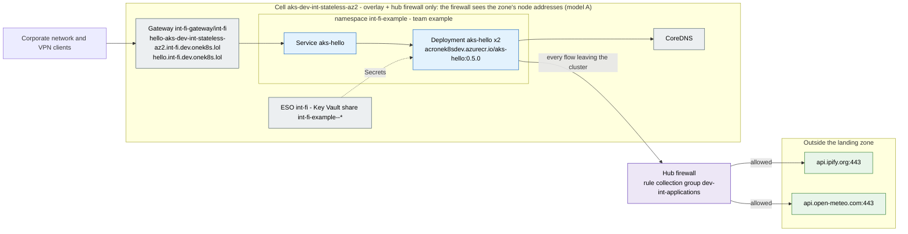

# Traffic flows of `int-fi-example`

Generated by the documentation agent of onek8s/aks-ai-agents (`aks-agent docs traffic`) from Git alone - the
application's configuration, its firewall rules in `stacks/platform-extensions/firewall-applications/dev-int/int-fi-example.yaml`,
the zone's allow-list and the cells' settings. Do not edit by hand: the next run overwrites it.

| | |
|---|---|
| Isolation zone | `int-fi` |
| Team, contact | example, https://github.com/onek8s/aks-fluxcd-example/issues |
| Configuration | [onek8s/aks-fluxcd-example / firewall-egress-int-fi](https://github.com/onek8s/aks-fluxcd-example/tree/main/firewall-egress-int-fi) |
| Cells | `aks-dev-int-stateful` (not running), `aks-dev-int-stateless-az1` (not running), `aks-dev-int-stateless-az2` |
| Egress model | overlay + hub firewall only: the firewall sees the zone's node addresses (model A) |

## Egress: what leaves the cluster, and who asked for it

The hub firewall's rules name the zone, not the application; the application's rule file does. Each row is
one destination with its status, the reason the rule file gives and where the application's configuration
names it.

| Destination | Port | Status | Rule | Why (from the rule) | Named in the configuration | Evidence |
|---|---|---|---|---|---|---|
| `api.ipify.org` | 443/https | allowed - the application's rule, named in its configuration | `dev-int-applications/int-fi-example-https-443` | aks-hello 0.5.0 fetches the public IP from api.ipify.org once at start, as configured in firewall-egress-int-fi/kustomization.yaml line 7-8. | mentioned in firewall-egress-int-fi/kustomization.yaml | 6 denied flows from pod aks-hello-77db47cfcd-bbfv9 in namespace int-fi-example on cluster aks-dev-int-stateless-az2, first seen 2026-10-16T09:12:57Z, last seen 2026-10-16T09:13:11Z The flow was denied by the hub firewall, which saw the node address (viaNode: true). |
| `api.open-meteo.com` | 443/https | allowed - the application's rule, named in its configuration | `dev-int-applications/int-fi-example-https-443` | aks-hello 0.4.1 fetches a Helsinki weather forecast from the internet (api.open-meteo.com) as described in apps/firewall-egress-int-fi/kustomization.yaml | Deployment aks-hello, WEATHER_URL mentioned in firewall-egress-int-fi/kustomization.yaml | 8 denied flows from pod aks-hello-895fcf8f8-jzfg6 in namespace int-fi-example on cluster aks-dev-int-stateless-az2, first seen 2026-10-16T04:43:17Z, last seen 2026-10-16T04:49:17Z The destination is named in apps/firewall-egress-int-fi/kustomization.yaml, line 6-10 The flow was denied by the hub firewall, which saw the node address (viaNode: true). The application configuration names this destination. |

The zone's allow-list and the platform's rules (open to every application of the zone, resp. from every cell)
are on the [zone's page](zone-int-fi.md); a name of theirs appears above only when this application's
configuration names it.

## Ingress: how it is reached

| Route | Hostnames | Gateway | Backends |
|---|---|---|---|
| `aks-hello` | `hello-aks-dev-int-stateless-az2.int-fi.dev.onek8s.lol` | `int-fi-gateway/int-fi` | `aks-hello` |
| `aks-hello-home` | `hello.int-fi.dev.onek8s.lol` | `int-fi-gateway/int-fi` | `aks-hello` |

## Workloads

| Workload | Replicas | Images | URLs in its environment |
|---|---|---|---|
| Deployment `aks-hello` | 2 | `acronek8sdev.azurecr.io/aks-hello:0.5.0` | `WEATHER_URL`: `https://api.open-meteo.com` |

## Notes

- Other cells sync another path of the same repository: aks-dev-int-stateful: apps, aks-dev-int-stateless-az1: stateless.

## Legend

- **allowed** (green): a rule in the application's file, and the application's configuration names the
  destination - the rule has a source.
- **allowed, not in the configuration** (amber): a rule in the application's file that nothing in its
  configuration names - a dependency the configuration hides (a library, a sidecar), or a rule to remove.
- **denied: no rule** (red, dashed): the configuration names it and no rule allows it - the firewall
  denies it until the egress agent's pull request is merged.
- **proposed** (purple, dashed): in an open pull request of the egress agent.
- **zone allow-list** (teal): on the zone's allow-list, open to every application of the zone; on an
  application's page only when its configuration names it.
- **platform rule** (grey): a rule of the platform for every cell of the exposure (the registry, Grafana
  Cloud, ...); on an application's page only when its configuration names it.

A rule opens its destination to the whole zone (the firewall tells zones apart, not applications within
one - design section 5.2): the zone's page shows the union.
